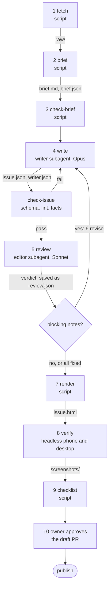

# The Rebuilders Anonymous newsletter: a short course

This skill is both the runbook and the textbook. Read the overview, then each step in order. Reference material lives next to this file in `reference/` and is linked where you need it.

## 1. Overview

**What it is.** A weekly newsletter for Rebuilders Anonymous, a 12-team dynasty fantasy football league on Sleeper ([league details](reference/league.md)). Each issue is one self-contained HTML page with a lead story, power rankings, six matchup recaps, awards, transactions, and next week's games. Its signature: the fantasy story is told through the real football. A fantasy score is explained by the box-score line and the NFL game that produced it. It's written in one voice, **Boston Connor**: a loud, overconfident, wildly biased Boston sports fan. The owner's guide, [`voice/boston-connor.md`](voice/boston-connor.md), is the single source of truth for tone. The takes are absurd on purpose; the facts never are.

**How it's made.** Scripts do everything with one right answer. Models do only the two jobs that need judgment: writing and editing. A human approves before anything publishes.

**The quality bar.** An issue is done when all of these are true:

- Every number traces to the brief, or to arithmetic on the brief that the fact check has recomputed.
- Every recap, the lead, and every award explain the fantasy result through real box-score numbers.
- The writing is Boston Connor, per [the guide](voice/boston-connor.md): the lead and every recap follow its five-step delivery, sentences are short and blunt, ALL CAPS is rare, not every sentence is a joke, no catchphrase repeats, and every absurd take reads as opinion about a real fact. The editor grades every item of the guide ([checklist](reference/voice-fidelity.md)).
- The page reads well on a phone: no sideways scroll, every manager can find their team in one tap, fonts embedded, nothing loaded from the network, and the Elo chart under the power rankings is readable at 390px.
- The editor has no open blocking notes, and the owner has approved the pull request.

**Who does what.** Every step ends in a named gate: a command that prints pass or fail and records the result in `newsletter/issues/<season>-week<N>/verification.json`.

| # | Step | Owner | Gate (in `verification.json`) | Gate command |
| --- | --- | --- | --- | --- |
| 1 | Fetch the week | script | `fetch.week_final` | `run.py fetch --week N` |
| 2 | Build the brief | script | `brief.reproducible` | `run.py brief --week N` |
| 3 | Check the brief | script | `brief.valid` | `run.py check-brief --week N` |
| 4 | Write the issue | writer subagent, Opus (`claude-opus-5-5[effort=high]`) | `issue.present`, `issue.schema`, `issue.lint`, `issue.facts` | `run.py check-issue --week N` |
| 5 | Review the draft | editor subagent, Sonnet (`claude-sonnet-5-5[effort=high]`) | `review.verdict` | `run.py check-review --week N` |
| 6 | Address blocking notes | writer subagent, Opus | `review.addressed` | `run.py check-review --week N` |
| 7 | Render | script | `render.reproducible` | `run.py render --week N` |
| 8 | Verify the page | script | `html.phone`, `html.desktop`, `html.screenshots` | `run.py verify --week N` |
| 9 | Final checklist | script | `checklist.final` | `run.py checklist --week N` |
| 10 | Approve and publish | human (the owner) | `owner.approved` | `run.py approval --week N` |

`run.py` is short for `python3 newsletter/run.py`. Run with no stage, `python3 newsletter/run.py --week N` runs steps 1 to 9 in order and stops at the first gate that doesn't pass. Exit code 0 means every automated gate passed, 1 means a gate failed, and 3 means the pipeline is waiting on a subagent's output.

**Words used here.** *Brief*: the week's data, joined and written to `brief.md` and `brief.json`; the only source of facts. *Gate*: a check with a pass or fail result and a command that reproduces it. *Subagent*: a separate Cursor agent with its own instructions and pinned model, defined in `.cursor/agents/`. *Main agent*: the agent running this skill; it runs the scripts and hands off to subagents. *Schema 3*: the current shape of `issue.json`. *Derived number*: a number in the copy that is arithmetic on brief numbers, such as a margin or a sum. *Elo*: the rating that orders the power rankings ([formula](reference/league.md#elo)). *Elo history*: the committed file `newsletter/elo/<season>.json`, one snapshot per week (including week 0 at 1000) that is never silently recalculated. *FAAB*: free agent acquisition budget, the $200 each team bids on waivers with. *Superflex*: a lineup slot that can hold a quarterback. *PPR*: a point per reception.

## 2. Before you start

- **Setup, once per machine.** Python 3.12. `pip install -r newsletter/requirements.txt` then `python3 -m playwright install chromium` (add `--with-deps` on a bare Linux box). Fetching, the brief, the checks, and rendering use only the standard library; Playwright is for step 8 and pytest for the tests.
- **When to run.** After Monday night's game is final and the Wednesday waiver run has processed (about 07:00 UTC Wednesday). The fetch gate enforces both, so running early is harmless: it stops and says what it's waiting for.
- **Branch.** Work on a new branch. GitHub Pages serves `main`, so merging publishes. Never edit an already-published week unless the owner asks.
- **Tests.** `python3 -m pytest newsletter/tests -q` checks the deterministic parts against the Week 4 data.

## 3. The steps

Each step has the same parts: what it does, why it exists, its inputs and outputs, who runs it, its gate, and what failure looks like.

### Step 1: Fetch the week

- **What.** Downloads the league, rosters, matchups for weeks 1 to N+1, transactions, Sleeper's NFL box scores, ESPN's scoreboard and game recaps, and player records.
- **Why.** Everything downstream must come from data saved in the repo, so anyone can rerun the pipeline and get the same issue.
- **In → out.** Week number → `raw/*.json` plus `raw/fetch_meta.json` (fetch time).
- **Run by.** Script: `python3 newsletter/run.py fetch --week N`. If `raw/` already holds the finished week, it's reused; `--refresh` pulls again.
- **Gate `fetch.week_final`.** Passes only when every NFL game of week N is final, every fantasy matchup has a score, and the waiver run after the week has processed. Nothing is written until then.
- **Failure and fix.** "week 5 is not ready: PHI VS JAX (In Progress) ..." means it's too early; rerun later. "network: ..." means a source didn't answer; rerun. If a source stays down, stop and tell the owner. Don't write around the gap.

### Step 2: Build the brief

- **What.** Joins `raw/` into one readable brief: standings, the Elo table, every matchup with each player's fantasy points next to their real stat line, NFL games with ESPN's recap text, transactions, FAAB, next week, injuries. [Full contents](reference/facts.md#what-the-brief-contains). It also records this week's Elo in `newsletter/elo/<season>.json`.
- **Why.** The writer and editor get one complete, trustworthy source and never touch an API. Elo is computed here, by code, so the rankings order is never a judgment call. The history file is the season's ledger: week N is computed from the recorded week N-1 ratings plus this week's games, then written. Past weeks are only read. If a recompute of a past week disagrees with the file, the step fails instead of quietly rewriting history.
- **In → out.** `raw/` plus `newsletter/elo/<season>.json` (weeks 0 through N-1) → `brief.md`, `brief.json`, and the same history file with week N appended or overwritten.
- **Run by.** Script: `python3 newsletter/run.py brief --week N`. No network. This is a script step, not a model step. Rerunning week N overwrites that week with the same numbers (idempotent) and leaves every other week alone.
- **Gate `brief.reproducible`.** The brief is built twice from the same `raw/` and both builds must be byte-identical, including the history file.
- **Failure and fix.** A failure means the builder has become non-deterministic (for example, iterating a set), or a past week in `newsletter/elo/<season>.json` no longer matches a recompute from `raw/`. Fix `fetch_week.build_brief` or restore the history file; never edit the brief or the history file by hand. A missing history file when recording any week after week 1 means the season was never backfilled (`python3 newsletter/elo.py --backfill --season 2026 --through 4` seeded 2026).

### Step 3: Check the brief

- **What.** Sanity-checks the brief: 12 teams and 6 matchups, each margin equals the score difference, each team's starters add up to its score, wins balance losses, points for balance points against, Elo recomputed from `raw/` matches, this week's Elo changes sum to zero, the table is in Elo order, the Elo history file has weeks 0 through N and this week matches the brief, every NFL game is final, and `brief.md` matches `brief.json`.
- **Why.** A bad brief makes every downstream check pass on wrong data. This is the one place to catch it.
- **Run by.** Script: `python3 newsletter/run.py check-brief --week N`.
- **Gate `brief.valid`.** Every check above passes. The details also count starters with no stat record, worth a look if it's more than a handful.
- **Failure and fix.** Each failure names the broken invariant. Fix the fetcher and rerun steps 1 to 3.

### Step 4: Write the issue (writer subagent, Opus)

- **What.** The writer reads the brief, picks the week's three most surprising facts, and writes every section of `issue.json` in the [fixed section order](reference/issue-schema.md), following the [Boston Connor guide](voice/boston-connor.md) exactly (with [worked examples](reference/voice.md)) and the [fact rules](reference/facts.md). It also writes `writer.json` with its story picks.
- **Why a model.** Finding the story and landing it in a very specific comic voice without bending a single fact is judgment. This is the reason the newsletter exists, so it gets the strongest writing model: **Opus**, pinned as `claude-opus-5-5[effort=high]` in `.cursor/agents/writer.md`.
- **In → out.** The voice guide, `brief.md`, `brief.json`, the reference files, and the previous week's issue if one exists (for structure only, never an older draft of this week) → `issue.json` (with its `derived` list) and `writer.json`.
- **Run by.** The main agent hands off to the `writer` subagent (see [Handoffs](#4-handoffs)).
- **Gates `issue.present`, `issue.schema`, `issue.lint`, `issue.facts`.** `python3 newsletter/run.py check-issue --week N`, which the writer runs itself until it exits 0:
  - *schema*: schema 3 holds and the template renders, the lead, recaps, and awards cite box-score stats, and there are 12 rankings, 6 recaps with two key performers a side, 4 or 5 awards, and 6 preview games.
  - *lint*: no banned filler, clichés, or vague praise (the guide's words, like fraud, bum, and pathetic, are allowed); the Boston Connor counts: at most 3 ALL-CAPS words per section and 6 per issue, an average sentence of 11 words or fewer and none over 32, no short sentence or four-word phrase repeated as a catchphrase, at most 4 exclamation marks and 4 swear words; plus at most three em dashes (none in headlines), no emoji, no internal labels like "W2", and no two ranking takes starting with the same word. [Thresholds and why](reference/voice.md#the-voice-checks).
  - *facts*: every number traces to the brief or to a recomputed `derived` entry, and rankings, recaps, key performers, standouts, preview pairings, and waiver bids match the brief field by field ([what it checks](reference/facts.md#what-the-fact-check-verifies)).
- **Failure and fix.** Each problem is one line, such as `not in brief: 17.64 in "Maye for Hurts ..."` or `recaps[2]: margin is '39.2', the brief says '39.16'`. The writer fixes the copy, or adds the arithmetic to `derived`, and reruns. It never edits the brief, the banned list, or the checks.

### Step 5: Review the draft (editor subagent, Sonnet)

- **What.** The editor checks what scripts can't: that each claim is attached to the right player and game, that reasons come from ESPN's text, that superlatives are true, that each `derived` number means what its sentence says, and that every absurd take reads as commentary rather than news. Then it grades the draft against **every item of the Boston Connor guide** in a `voice_fidelity` section ([the checklist](reference/voice-fidelity.md)), including the five-step delivery for the lead and each recap, quoted step by step. It returns a verdict with numbered notes, each **blocking** (facts, invented news or context, any voice miss that breaks the guide, banned phrasing the lint missed, real-life roasting, a section that misses its job) or **non-blocking** (taste within the voice).
- **Why a model, and why a different one.** Critique is judgment too, but it's reading against a checklist rather than creating, so **Sonnet** (`claude-sonnet-5-5[effort=high]`, pinned in `.cursor/agents/editor.md`) is enough. A second model also doesn't share the writer's blind spots. The editor is read-only (`readonly: true`): it can never edit the issue.
- **In → out.** The voice guide, the voice-fidelity checklist, `brief.md`, `brief.json`, `issue.json`, `verification.json`, and the reference files → a JSON verdict in its reply, which the main agent saves with `python3 newsletter/run.py record-review --week N --from <file>`. That command validates the shape, stamps the verdict with the reviewed issue's SHA-256 hash and the editor's pinned model, and writes `review.json` (keeping earlier rounds as `review.r1.json` and so on).
- **Gate `review.verdict`.** `python3 newsletter/run.py check-review --week N`: `review.json` has a valid shape, `verdict` is `approve` exactly when there are no blocking notes, `voice_fidelity` has a pass or miss with evidence for every guide item and every delivery unit, every miss cites a blocking note, and its model matches the editor's agent file.
- **Failure and fix.** A malformed verdict fails `record-review` with the reason; ask the editor again.

### Step 6: Address blocking notes (writer subagent, Opus)

- **What.** If the verdict has blocking notes, the writer fixes each one, reruns `check-issue`, and records a response per note in `writer.json`: `{"note_id": "E1", "status": "fixed", "change": "..."}`.
- **Why.** A note nobody answers is a note nobody fixed. This turns review into a contract that a script can check.
- **Gate `review.addressed`** (also from `check-review`). Passes when the editor approved the current `issue.json` exactly, or when every blocking note has a `fixed` response, `writer.json` answers the latest review round, and `issue.json` has changed since the review. It fails if the issue changed after an approval, so a late edit has to go back to the editor.
- **Failure and fix.** "blocking note E3 has no 'fixed' response" means hand back to the writer. If the fixes were large, run the editor again (round 2) for a fresh verdict.

### Step 7: Render

- **What.** Fills the Card Back template with `issue.json`, embeds the fonts as data URLs, draws the Elo progression chart as inline SVG from `newsletter/elo/<season>.json`, and writes one self-contained `issue.html` in the issue folder.
- **Why.** The design is final ([Card Back notes](reference/design.md)); rendering is mechanical and must never drift. The chart is generated in Python at render time so the HTML stays one file: no JavaScript, no CSS from the network, no fonts from a CDN.
- **Run by.** Script: `python3 newsletter/run.py render --week N`. It refuses if the issue no longer passes schema, lint, and facts, or if the chart is missing.
- **Gate `render.reproducible`.** Two renders of the same issue are byte-identical, the file's hash is recorded, and the HTML contains the 12-team Elo chart (`#elo-chart`).
- **Failure and fix.** A check failure here means `issue.json` changed after step 4, or the history file is missing this week; rerun from `check-issue` or `brief`. Never render to the repo root: a root-level page publishes once merged.

### Step 8: Verify the page

- **What.** Opens `issue.html` in headless Chromium at phone (390px) and desktop (1280px) widths and checks: no horizontal scroll, no network requests, every font loaded, no console errors, no `{{` left over, all twelve "Find your team" links landing on their cards, and the Elo chart present (12 lines, weekly points, 12-name legend). Saves four screenshots.
- **Why.** Most readers open the issue on a phone. These are the failures that made past issues look broken.
- **Run by.** Script: `python3 newsletter/run.py verify --week N` (or `python3 newsletter/verify_html.py <html>` for the raw JSON report).
- **Gates `html.phone`, `html.desktop`, `html.screenshots`.** Every check passes at each width, and all four screenshots exist.
- **Failure and fix.** A long unbroken string can cause sideways scroll: shorten it in the copy. A network request or font failure means the template or fonts changed; restore them from `main`. Template problems go to the owner, not into a restyle.

### Step 9: Final checklist

- **What.** Re-checks everything in one place: every earlier gate passed; the issue still passes schema, lint, and facts; `issue.html` is the render of the current `issue.json`; the HTML gates checked this exact file; the editor gate still holds; nothing is marked as sample data; `newsletter/elo/<season>.json` has weeks 0 through N and matches the brief; the rendered HTML includes the Elo chart; `2026-week2.html`, `rebuilders-anonymous-draft-review.html`, `README.md`, the template, and the fonts are unchanged from `main`; no new page sits at the repo root; and no live page links to `newsletter/issues/`.
- **Why.** Single stages can be rerun out of order. This gate makes sure the files going into the PR are the files that were checked.
- **Run by.** Script: `python3 newsletter/run.py checklist --week N`.
- **Gate `checklist.final`.** Every item passes.
- **Failure and fix.** Each item names what to rerun or restore.

### Step 10: Approve and publish (the owner)

- **What.** The main agent commits the issue folder (`raw/`, `brief.*`, `issue.json`, `writer.json`, `review*.json`, `issue.html`, `screenshots/`, `verification.json`) on a branch and opens a **draft** pull request with the phone screenshot and the gate table from `verification.json`. The owner reads the preview and approves the PR, or asks for changes, which go back through the writer.
- **Why.** The newsletter roasts real people by name. A person who knows them signs off. Nothing publishes without that.
- **Gate `owner.approved`.** A full run records it as `pending`. `python3 newsletter/run.py approval --week N` reads the PR's review decision from GitHub and passes only when it's `APPROVED`.
- **Publishing** is a separate step taken only on the owner's instruction: render the approved issue to the repo root (`python3 newsletter/build.py --data <issue.json> --out <season>-week<N>.html`), link it from `README.md`, and merge. GitHub Pages serves `main`.

## 4. Handoffs

The main agent runs every script and is the only one that hands work to a subagent. Each handoff names the files the subagent reads and writes, and ends at a gate the main agent runs itself. `python3 newsletter/run.py handoff --agent writer --week N` (or `--agent editor`) prints this contract as JSON.

| Subagent | Agent file | Model | Reads | Writes | Gate the main agent runs after |
| --- | --- | --- | --- | --- | --- |
| writer | `.cursor/agents/writer.md` | `claude-opus-5-5[effort=high]` | `voice/boston-connor.md` (follow exactly), `reference/voice.md`, `reference/voice-fidelity.md`, `reference/facts.md`, `reference/issue-schema.md`, `brief.md`, `brief.json`, the previous week's `issue.json` if any (structure), `review.json` (revisions) | `issue.json`, `writer.json` | `check-issue`, then `check-review` on revisions |
| editor | `.cursor/agents/editor.md` | `claude-sonnet-5-5[effort=high]` | `voice/boston-connor.md` (review against it), `reference/voice-fidelity.md`, `reference/voice.md`, `reference/facts.md`, `brief.md`, `brief.json`, `issue.json`, `verification.json` | nothing: returns the verdict JSON with `voice_fidelity` and notes | `record-review`, then `check-review` |

The main agent's loop for week N:

0. **Redoing a week that already has an issue?** The run only stops for the writer when there is no `issue.json`, so move the old copy out first: `cd newsletter/issues/<season>-week<N> && rm -rf issue.json writer.json review*.json issue.html screenshots verification.json`. Keep `raw/` only if you don't want fresh data.
1. `python3 newsletter/run.py --week N` (add `--refresh` to download fresh data even if `raw/` holds a finished week). It runs steps 1 to 3 and stops with exit 3 at `issue.present`.
2. Invoke the `writer` subagent with the issue folder and week: `/writer` in the Cursor chat, or the Task tool with the writer's agent type. If the custom agent isn't registered in your session (agent files load when a session starts), launch a general-purpose subagent on the same model (`claude-opus-5-5-high`) and give it the body of `.cursor/agents/writer.md` as its instructions; never fall back to a different model. When it returns, run `python3 newsletter/run.py check-issue --week N`. If it fails, resume the writer with the output.
3. Invoke the `editor` subagent with the issue folder (same fallback: a general-purpose subagent on `claude-sonnet-5-5-high` with the body of `.cursor/agents/editor.md`, told it is read-only). Save its JSON reply to a file outside the issue folder and run `python3 newsletter/run.py record-review --week N --from <file>`.
4. If the verdict has blocking notes, resume the writer with `review.json` (step 6), then run `check-issue` and `check-review`. Repeat the editor if the fixes were substantial.
5. `python3 newsletter/run.py --week N` again. It reuses the fetch, re-checks everything, renders, verifies, runs the checklist, and exits 0 with `owner.approved` pending.
6. Commit, push, and open the draft PR (step 10).

No other model steps exist. Everything else has one right answer and is a script. Add a model step only for a job that needs judgment, pin it to Opus or Sonnet in its own agent file, and add it to the table above with the reason.

## 5. Reading `verification.json`

One file per issue. The top level has `result` (`pass`, `fail`, or `waiting`), `stopped_at` (the stage that stopped the run), `next_action` (what to do next, in words), the pinned `models`, and SHA-256 hashes of the brief, issue, review, and HTML. `gates` lists every gate in step order, each with `gate`, `step`, `owner`, `status` (`pass`, `fail`, `waiting`, or `pending`), `checked_at` (UTC), the `command` that reproduces it, and `details` (the problems on failure, the evidence on a pass). A full run starts the file fresh; a single stage updates only its own gates.

## 6. Adapting the process to another league

The pipeline separates what's specific to this league from what isn't. To run it for another Sleeper league:

1. **League ID and season.** Change `LEAGUE_ID` in `newsletter/fetch_week.py` (or pass `--league`) and pass `--season`. Everything Sleeper-side, including scoring, lineup slots, and team names, is read from the league itself.
2. **League size.** The checks assume 12 teams and 6 games: `validate()` in `newsletter/build.py`, `brief_problems()` in `newsletter/run.py`, and the Find-your-team count in `newsletter/verify_html.py`. Make those numbers come from the brief's team count.
3. **Rankings.** Elo with K = 32 suits a 14-week season. If the league wants another order, change `elo_table()` and keep it in code, so the order stays a fact and not a taste. Start a new season's history file with `python3 newsletter/elo.py --backfill --season <Y> --through 1` after week 1, then let the brief step append each later week.
4. **Voice.** Get a voice guide from the new league's owner and commit it verbatim under `voice/`. Point the writer and editor agent files and `VOICE_GUIDE` in `run.py` at it, rewrite the item table in `reference/voice-fidelity.md` to match the new guide's items, rewrite the examples and banned list in `reference/voice.md`, and retune the `VOICE` thresholds in `build.py` on a real issue.
5. **League facts.** Replace `reference/league.md` (scoring, teams, history).
6. **Design.** Pick a template with the owner using `.cursor/skills/frontend-design/SKILL.md`, and set `TEMPLATE` in `build.py`. The HTML gate works for any template that keeps the `#teams` jump list.
7. **Another platform** (ESPN or Yahoo fantasy). Rewrite only `fetch_raw()` so it saves the same `raw/` shapes, or adapt `build_brief()`. Every step after the brief is platform-neutral.
8. **Run the tests** with a finished week of the new league as the fixture, and pin its Elo values the way `test_elo_reproduces_week4` does.

## Reference

- [voice/boston-connor.md](voice/boston-connor.md): the owner's voice guide, verbatim. The single source of truth for tone.
- [reference/voice.md](reference/voice.md): the guide applied to real Week 4 facts, the banned phrases, and the voice checks with their thresholds.
- [reference/voice-fidelity.md](reference/voice-fidelity.md): the editor's item-by-item checklist against the guide.
- [reference/facts.md](reference/facts.md): sources of truth, the fact check, the `derived` list, what the brief contains.
- [reference/issue-schema.md](reference/issue-schema.md): section order and every field of schema 3.
- [reference/league.md](reference/league.md): the league, teams, the Elo formula, and the weekly history file.
- [reference/design.md](reference/design.md): Card Back, the owner's design notes, the Elo chart, and the HTML checks.
- `.cursor/agents/writer.md`, `.cursor/agents/editor.md`: the two subagents.
- `newsletter/run.py`, `fetch_week.py`, `elo.py`, `build.py`, `verify_html.py`: the scripts. `newsletter/tests/`: the tests. `newsletter/elo/`: the committed weekly Elo history.
